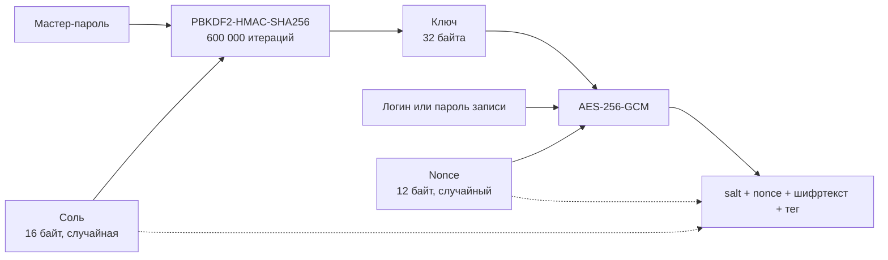

# HSE Password Manager

Консольный менеджер паролей. Записи хранятся в JSON-файле, логины и пароли в нём зашифрованы. Доступ только по мастер-паролю.

## Возможности

- вход по мастер-паролю, сам мастер-пароль нигде не хранится;
- добавление, просмотр списка, получение и удаление записей;
- скрытый ввод паролей;
- шифрование логинов и паролей (AES-256-GCM, ключ из мастер-пароля через PBKDF2);
- генератор случайных паролей;
- понятные сообщения об ошибках вместо трейсбеков.

## Требования

- Python 3.15 или новее;
- [uv](https://docs.astral.sh/uv/).

## Установка

```bash
git clone https://github.com/nontypeable/hse-password-manager.git
cd hse-password-manager
uv sync --all-groups
```

## Запуск

Все команды выполняются из корня проекта.

```bash
# Создать хранилище и задать мастер-пароль
uv run python -m password_manager --init

# Войти и работать с записями
uv run python -m password_manager --unlock

# Сгенерировать пароль, не открывая хранилище
uv run python -m password_manager --generate        # 8 символов
uv run python -m password_manager --generate 20     # своя длина

# Хранить данные в другом файле
uv run python -m password_manager --file ~/my-vault.json --unlock
```

### Команды меню

После `--unlock` доступны команды:

| Команда            | Что делает                                      |
| ------------------ | ----------------------------------------------- |
| `add [имя]`        | добавить запись                                 |
| `list`             | показать имена записей (пароли не показываются) |
| `get <имя>`        | показать логин и пароль                         |
| `delete <имя>`     | удалить запись                                  |
| `generate [длина]` | сгенерировать пароль                            |
| `exit`             | выйти                                           |

Минимальная длина пароля — 8 символов, меньшее значение приводит к ошибке.

## Как это устроено



Формат файла:

```json
{
  "meta": { "check": "<base64: salt + nonce + шифртекст>" },
  "entries": {
    "github": { "login": "<base64>", "password": "<base64>" }
  }
}
```

Файл записывается через временный файл и `os.replace` с правами `0600`.

### Ограничения

- Имена записей хранятся открытым текстом, шифруются только логины и пароли.
- Смены мастер-пароля нет.
- Блокировок нет: два процесса, пишущие в один файл одновременно, могут затереть изменения друг друга.
